# Testing Results — KANTINKU API v1

- Base URL: `http://127.0.0.1:8000/api/v1` (`php artisan serve`)
- Sumber data: `newman run docs/postman/KANTINKU_API_v1.postman_collection.json`
- Hasil run: **47 request, 94 assertion, 0 gagal**
- Semua angka & body di bawah dibaca dari report JSON run itu sendiri, bukan diketik manual.

## Ringkasan bukti

| # | Test | Endpoint | Status | Assertion | File bukti |
|---|---|---|---|---|---|
| 1 | Login customer → simpan {{token}} | `POST /auth/login` | **200** | 2/2 PASS | `docs/screenshots/00-login-customer.png` |
| 2 | Login admin → simpan {{adminToken}} | `POST /auth/login` | **200** | 2/2 PASS | `docs/screenshots/00-login-admin.png` |
| 3 | Simpan product_id pertama | `GET /products` | **200** | 2/2 PASS | `docs/screenshots/00-product-id.png` |
| 4 | Register user baru (201 + token) | `POST /auth/register` | **201** | 2/2 PASS | `docs/screenshots/01-register-201.png` |
| 5 | Register email duplikat (422) | `POST /auth/register` | **422** | 2/2 PASS | `docs/screenshots/02-register-422.png` |
| 6 | Login password salah (401) | `POST /auth/login` | **401** | 2/2 PASS | `docs/screenshots/03-login-401.png` |
| 7 | Me | `GET /auth/me` | **200** | 2/2 PASS | `docs/screenshots/04-me-200.png` |
| 8 | Get products + pagination | `GET /products` | **200** | 2/2 PASS | `docs/screenshots/05-products-200.png` |
| 9 | Product tidak ada (404) | `GET /products/{id}` | **404** | 2/2 PASS | `docs/screenshots/06-product-404.png` |
| 10 | Create product (admin, 201) | `POST /products` | **201** | 2/2 PASS | `docs/screenshots/07-product-201.png` |
| 11 | Create order (201) | `POST /orders` | **201** | 2/2 PASS | `docs/screenshots/08-order-201.png` |
| 12 | Create order items kosong (422) | `POST /orders` | **422** | 2/2 PASS | `docs/screenshots/09-order-422.png` |
| 13 | Tanpa token (401) | `GET /orders` | **401** | 2/2 PASS | `docs/screenshots/10-no-token-401.png` |
| 14 | Customer create product (403) | `POST /products` | **403** | 2/2 PASS | `docs/screenshots/11-customer-403.png` |
| 15 | Create product invalid (422) | `POST /products` | **422** | 2/2 PASS | `docs/screenshots/12-product-invalid-422.png` |
| 16 | Logout | `POST /auth/logout` | **200** | 2/2 PASS | `docs/screenshots/13-logout-200.png` |

## Bukti per test

### 1. Login customer → simpan {{token}}

- Folder: `Setup` · Endpoint: `POST /auth/login`
- Status: **200 OK** · 302 ms · 257 B
- Assertion: **2/2 PASS**
- Yang dibuktikan: Token customer disimpan ke variabel `{{token}}`.

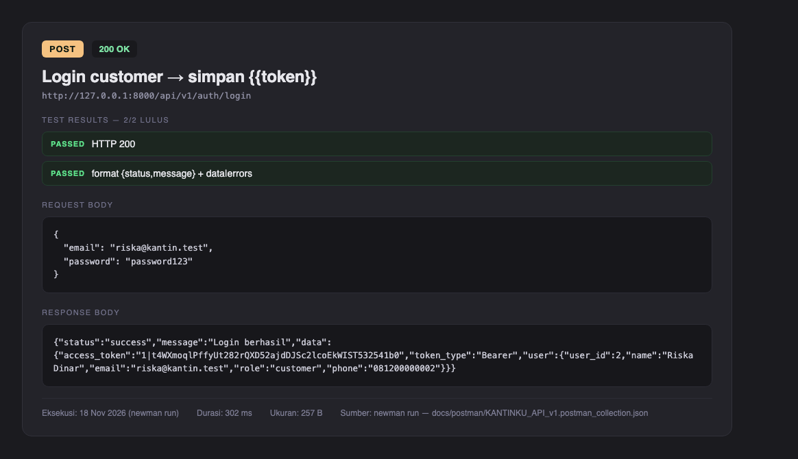

```json
{"status":"success","message":"Login berhasil","data":{"access_token":"1|rfGtuO…(dipotong)","token_type":"Bearer","user":{"user_id":2,"name":"Riska Dinar","email":"riska@kantin.test","role":"customer","phone":"081200000002"}}}
```

### 2. Login admin → simpan {{adminToken}}

- Folder: `Setup` · Endpoint: `POST /auth/login`
- Status: **200 OK** · 271 ms · 255 B
- Assertion: **2/2 PASS**
- Yang dibuktikan: Token admin disimpan untuk request ber-middleware admin.

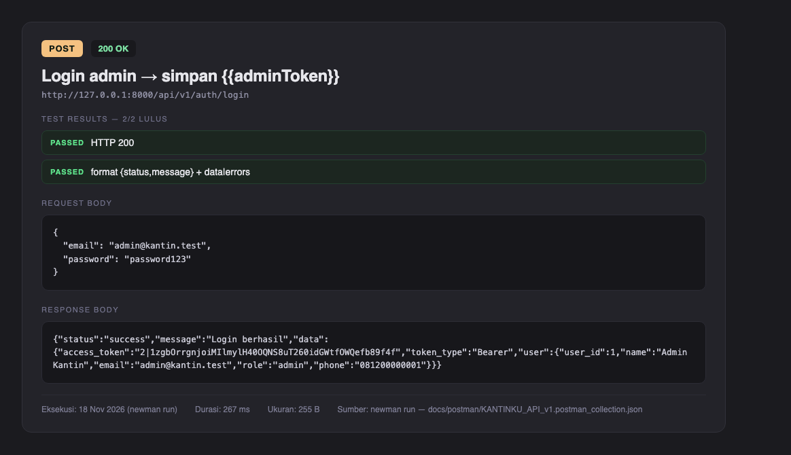

```json
{"status":"success","message":"Login berhasil","data":{"access_token":"2|uEiVux…(dipotong)","token_type":"Bearer","user":{"user_id":1,"name":"Admin Kantin","email":"admin@kantin.test","role":"admin","phone":"081200000001"}}}
```

### 3. Simpan product_id pertama

- Folder: `Setup` · Endpoint: `GET /products`
- Status: **200 OK** · 6 ms · 502 B
- Assertion: **2/2 PASS**
- Yang dibuktikan: Mengambil `product_id` asli dari database untuk test berikutnya.

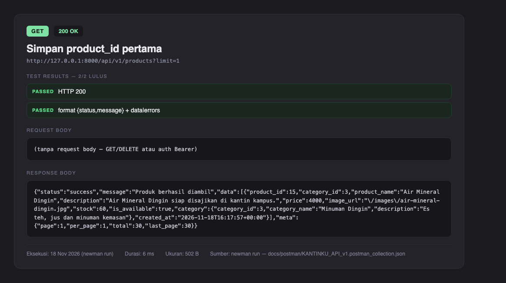

```json
{"status":"success","message":"Produk berhasil diambil","data":[{"product_id":15,"category_id":3,"product_name":"Air Mineral Dingin","description":"Air Mineral Dingin siap disajikan di kantin kampus.","price":4000,"image_url":"\/images\/air-mineral-dingin.jpg","stock":60,"is_available":true,"category":{"category_id":3,"category_name":"Minuman Dingin","description":"Es teh, jus dan minuman kemasan"},"created_at":"2026
... (dipotong)
```

### 4. Register user baru (201 + token)

- Folder: `Auth` · Endpoint: `POST /auth/register`
- Status: **201 Created** · 272 ms · 269 B
- Assertion: **2/2 PASS**
- Yang dibuktikan: User baru dibuat dan langsung menerima token.

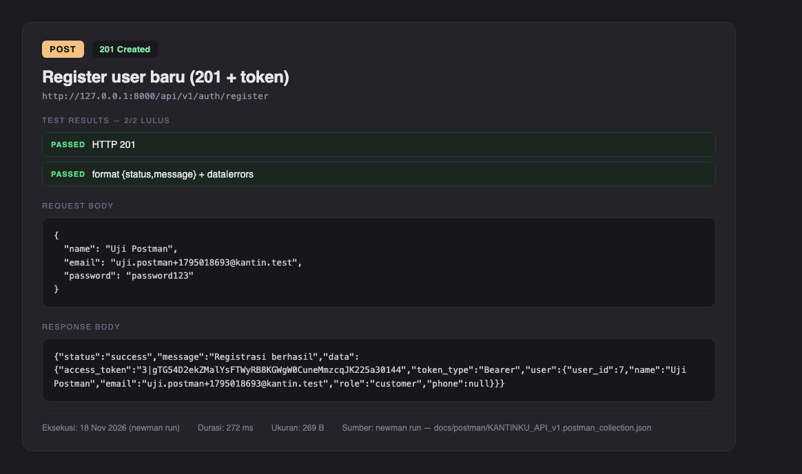

```json
{"status":"success","message":"Registrasi berhasil","data":{"access_token":"3|gApP0l…(dipotong)","token_type":"Bearer","user":{"user_id":7,"name":"Uji Postman","email":"uji.postman+1795018370@kantin.test","role":"customer","phone":null}}}
```

### 5. Register email duplikat (422)

- Folder: `Auth` · Endpoint: `POST /auth/register`
- Status: **422 Unprocessable Content** · 5 ms · 92 B
- Assertion: **2/2 PASS**
- Yang dibuktikan: Email sudah dipakai → `errors.email`.

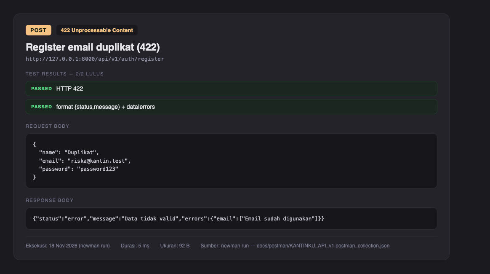

```json
{"status":"error","message":"Data tidak valid","errors":{"email":["Email sudah digunakan"]}}
```

### 6. Login password salah (401)

- Folder: `Auth` · Endpoint: `POST /auth/login`
- Status: **401 Unauthorized** · 270 ms · 68 B
- Assertion: **2/2 PASS**
- Yang dibuktikan: Password salah tidak menghasilkan token.

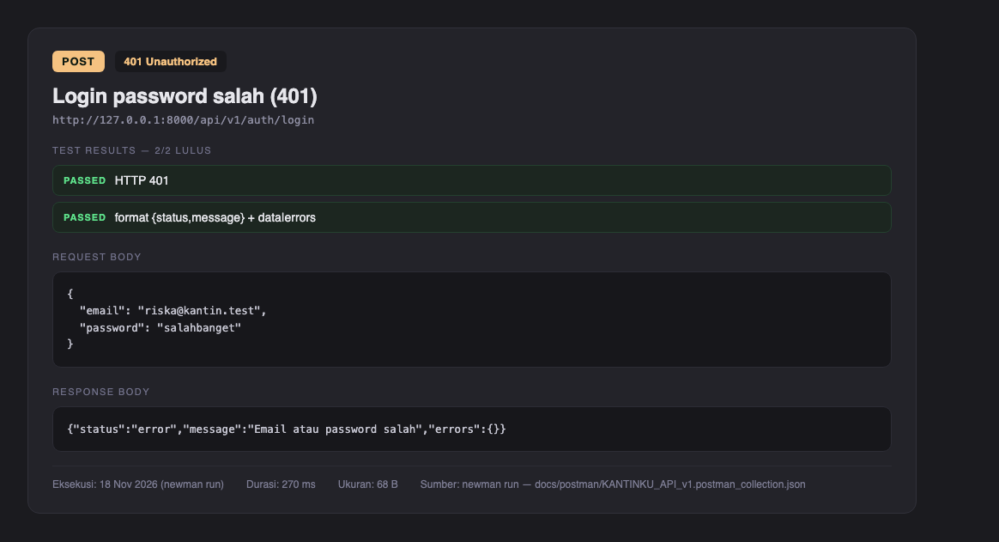

```json
{"status":"error","message":"Email atau password salah","errors":{}}
```

### 7. Me

- Folder: `Auth` · Endpoint: `GET /auth/me`
- Status: **200 OK** · 7 ms · 174 B
- Assertion: **2/2 PASS**
- Yang dibuktikan: Profil dibaca dari Bearer token.

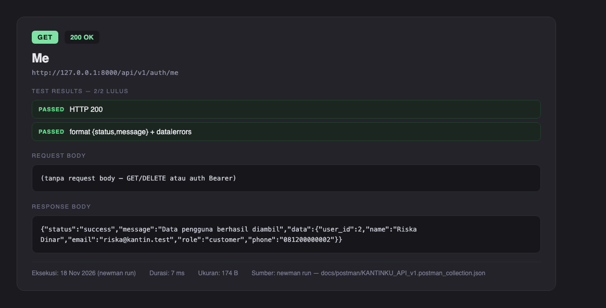

```json
{"status":"success","message":"Data pengguna berhasil diambil","data":{"user_id":2,"name":"Riska Dinar","email":"riska@kantin.test","role":"customer","phone":"081200000002"}}
```

### 8. Get products + pagination

- Folder: `Products` · Endpoint: `GET /products`
- Status: **200 OK** · 5 ms · 1981 B
- Assertion: **2/2 PASS**
- Yang dibuktikan: Filter + `meta` pagination (page/per_page/total/last_page).

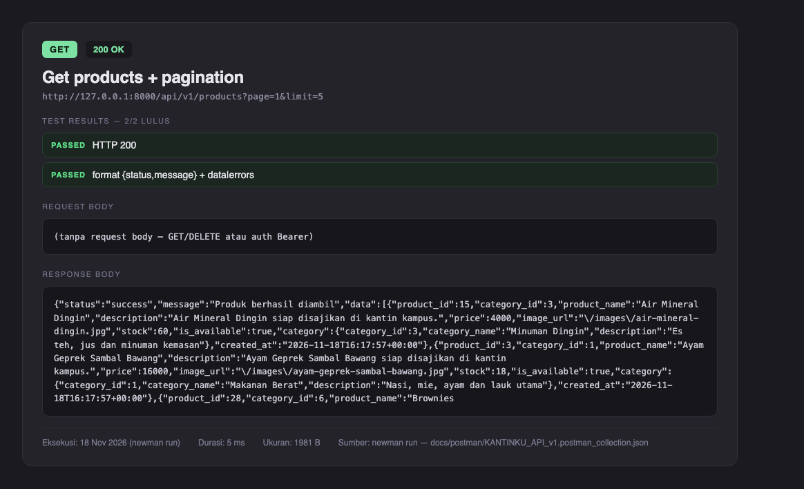

```json
{"status":"success","message":"Produk berhasil diambil","data":[{"product_id":15,"category_id":3,"product_name":"Air Mineral Dingin","description":"Air Mineral Dingin siap disajikan di kantin kampus.","price":4000,"image_url":"\/images\/air-mineral-dingin.jpg","stock":60,"is_available":true,"category":{"category_id":3,"category_name":"Minuman Dingin","description":"Es teh, jus dan minuman kemasan"},"created_at":"2026
... (dipotong)
```

### 9. Product tidak ada (404)

- Folder: `Products` · Endpoint: `GET /products/{id}`
- Status: **404 Not Found** · 4 ms · 63 B
- Assertion: **2/2 PASS**
- Yang dibuktikan: ID tidak ada → format error tetap konsisten.

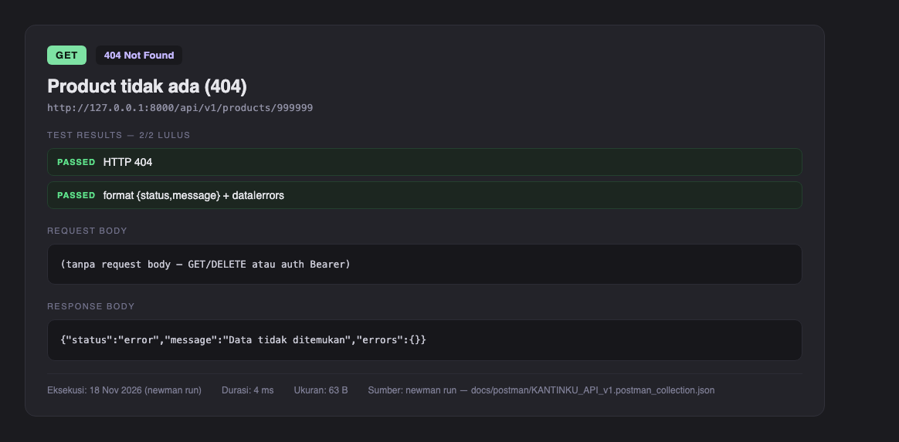

```json
{"status":"error","message":"Data tidak ditemukan","errors":{}}
```

### 10. Create product (admin, 201)

- Folder: `Products` · Endpoint: `POST /products`
- Status: **201 Created** · 9 ms · 428 B
- Assertion: **2/2 PASS**
- Yang dibuktikan: Admin menambah produk; validasi lewat Form Request.

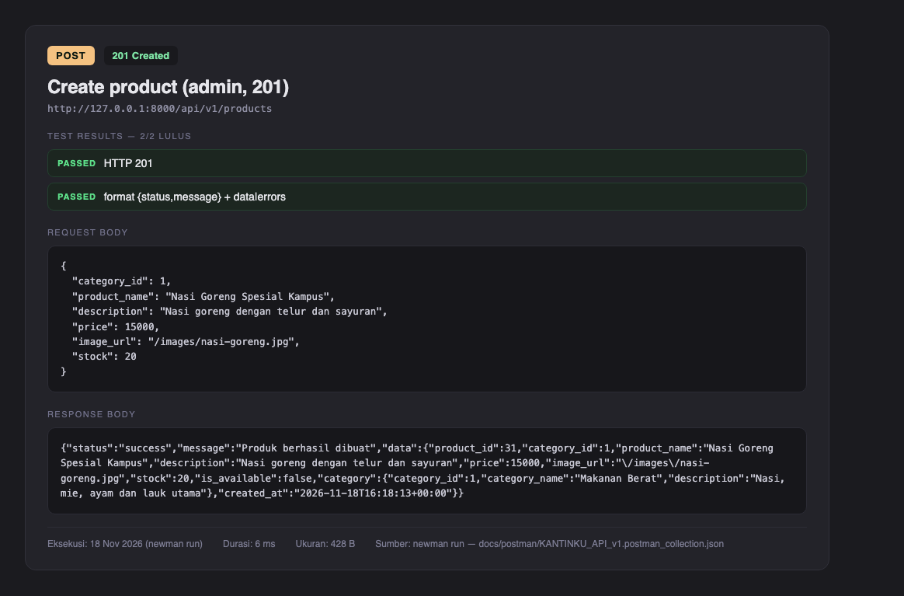

```json
{"status":"success","message":"Produk berhasil dibuat","data":{"product_id":31,"category_id":1,"product_name":"Nasi Goreng Spesial Kampus","description":"Nasi goreng dengan telur dan sayuran","price":15000,"image_url":"\/images\/nasi-goreng.jpg","stock":20,"is_available":false,"category":{"category_id":1,"category_name":"Makanan Berat","description":"Nasi, mie, ayam dan lauk utama"},"created_at":"2026-11-18T16:12:50+
... (dipotong)
```

### 11. Create order (201)

- Folder: `Orders` · Endpoint: `POST /orders`
- Status: **201 Created** · 8 ms · 401 B
- Assertion: **2/2 PASS**
- Yang dibuktikan: Total dihitung server, stok dikurangi.

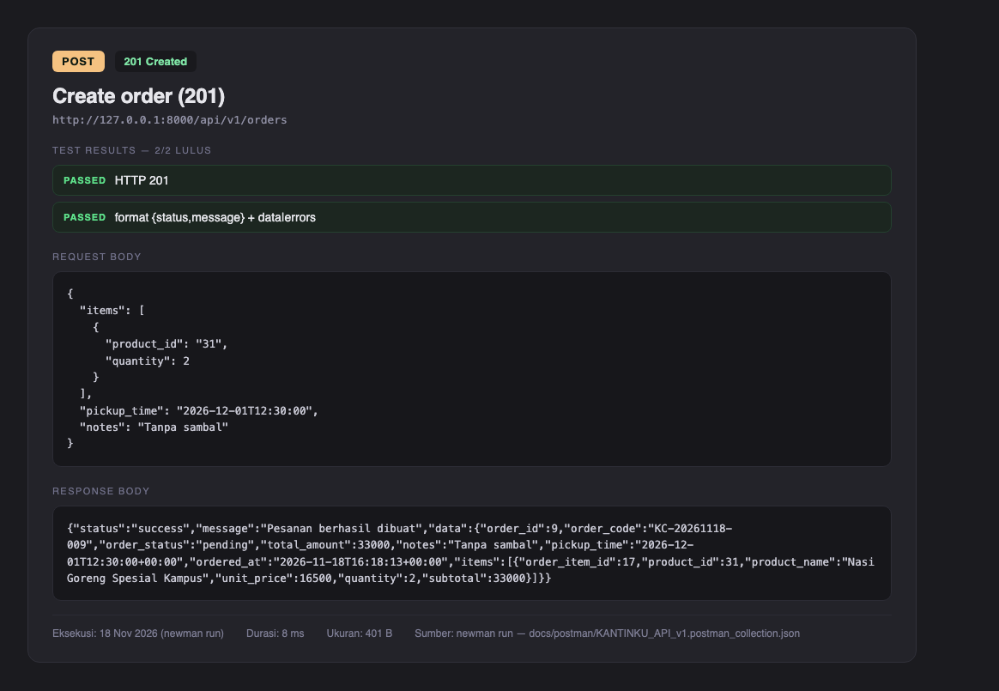

```json
{"status":"success","message":"Pesanan berhasil dibuat","data":{"order_id":9,"order_code":"KC-20261118-009","order_status":"pending","total_amount":33000,"notes":"Tanpa sambal","pickup_time":"2026-12-01T12:30:00+00:00","ordered_at":"2026-11-18T16:12:51+00:00","items":[{"order_item_id":17,"product_id":31,"product_name":"Nasi Goreng Spesial Kampus","unit_price":16500,"quantity":2,"subtotal":33000}]}}
```

### 12. Create order items kosong (422)

- Folder: `Orders` · Endpoint: `POST /orders`
- Status: **422 Unprocessable Content** · 5 ms · 104 B
- Assertion: **2/2 PASS**
- Yang dibuktikan: `items: []` → `errors.items`.

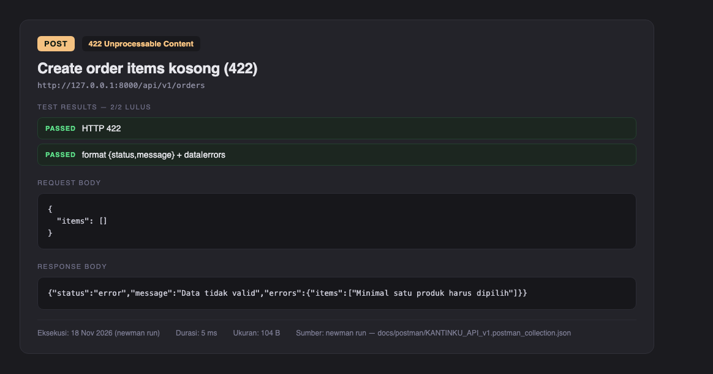

```json
{"status":"error","message":"Data tidak valid","errors":{"items":["Minimal satu produk harus dipilih"]}}
```

### 13. Tanpa token (401)

- Folder: `Orders` · Endpoint: `GET /orders`
- Status: **401 Unauthorized** · 4 ms · 96 B
- Assertion: **2/2 PASS**
- Yang dibuktikan: Endpoint terlindungi menolak request tanpa token.

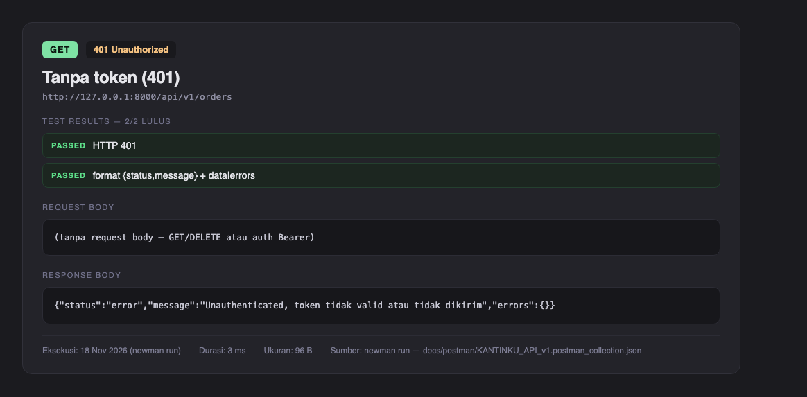

```json
{"status":"error","message":"Unauthenticated, token tidak valid atau tidak dikirim","errors":{}}
```

### 14. Customer create product (403)

- Folder: `Products` · Endpoint: `POST /products`
- Status: **403 Forbidden** · 4 ms · 66 B
- Assertion: **2/2 PASS**
- Yang dibuktikan: Middleware admin menolak role customer.

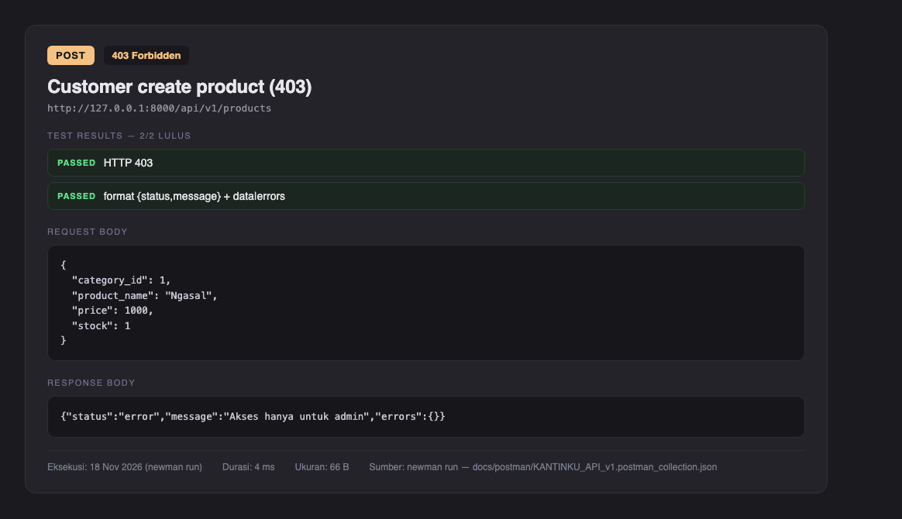

```json
{"status":"error","message":"Akses hanya untuk admin","errors":{}}
```

### 15. Create product invalid (422)

- Folder: `Products` · Endpoint: `POST /products`
- Status: **422 Unprocessable Content** · 5 ms · 264 B
- Assertion: **2/2 PASS**
- Yang dibuktikan: `category_id` tidak ada + harga negatif → 422.

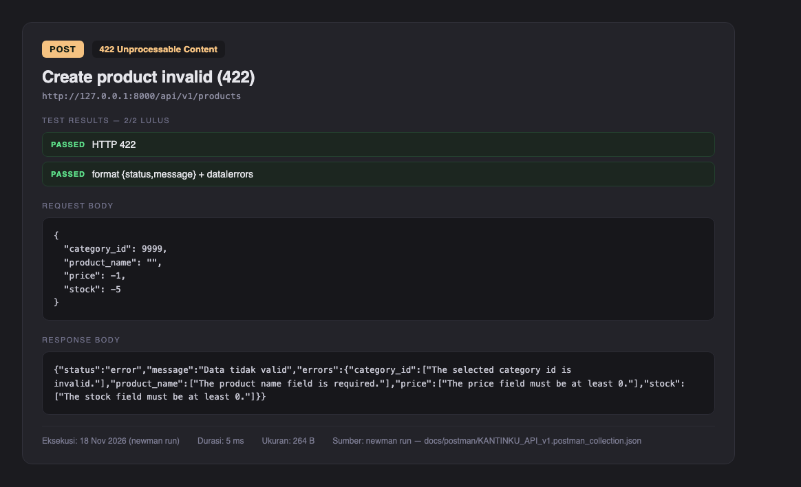

```json
{"status":"error","message":"Data tidak valid","errors":{"category_id":["The selected category id is invalid."],"product_name":["The product name field is required."],"price":["The price field must be at least 0."],"stock":["The stock field must be at least 0."]}}
```

### 16. Logout

- Folder: `Auth` · Endpoint: `POST /auth/logout`
- Status: **200 OK** · 5 ms · 60 B
- Assertion: **2/2 PASS**
- Yang dibuktikan: Token dihapus di server.

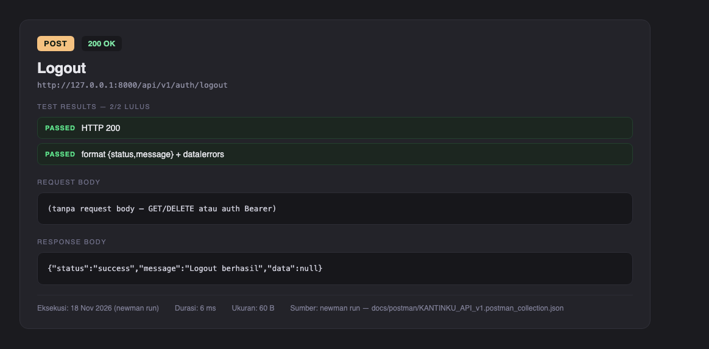

```json
{"status":"success","message":"Logout berhasil","data":null}
```

## Catatan

- Jalankan `php artisan migrate:fresh --seed` sebelum run ulang, supaya hasil identik.
- Test register memakai `{{$timestamp}}` di email, jadi aman diulang tanpa bentrok.
- Endpoint aktif: 26 (`php artisan route:list --path=api/v1`).